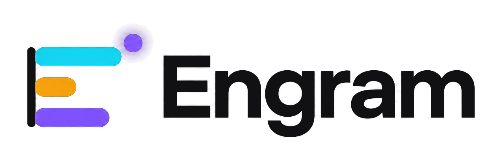
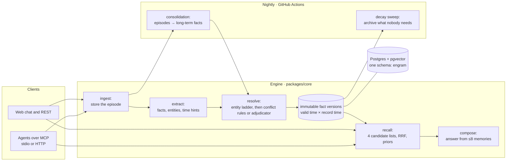
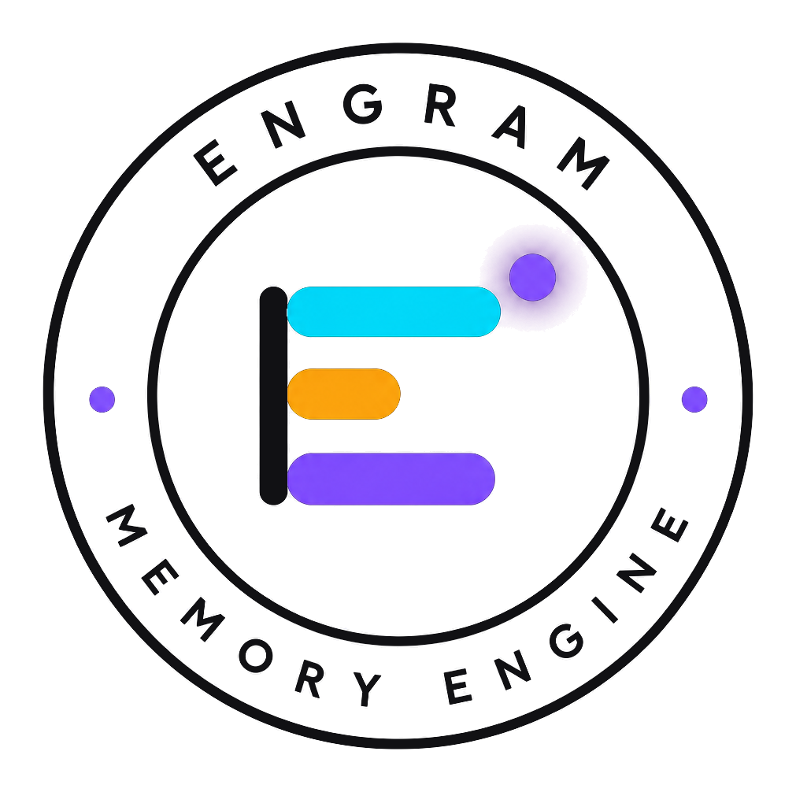

<p align="center">
  <picture>
    <source media="(prefers-color-scheme: dark)" srcset="assets/brand/primary-dark.png">
    
  </picture>
</p>

<h3 align="center">Persistent memory for AI agents, with the time every fact was true <i>and</i> the time it was believed.</h3>

<p align="center">
  <a href="https://github.com/Pranav-Singh-Devloper/Engram/actions/workflows/ci.yml"></a>
  <a href="https://github.com/Pranav-Singh-Devloper/Engram/actions/workflows/nightly.yml"></a>
  
  
  
  
  
  
</p>

<p align="center">
  <a href="https://engram-lime.vercel.app"><b>Live demo</b></a> ·
  <a href="https://engram-lime.vercel.app/architecture"><b>Architecture explorer</b></a> ·
  <a href="#benchmarks">Benchmarks</a> ·
  <a href="#use-it-from-an-mcp-client">MCP setup</a> ·
  <a href="docs/architecture.md">Design notes</a> ·
  <a href="DECISIONS.md">Decision log</a>
</p>

Engram remembers what users say across sessions, keeps every fact with both the time it was true and the time it was believed, resolves contradictions, forgets what nobody needs, and consolidates conversations into lasting knowledge. Agents use it over MCP.

<!-- hero:start --><!-- hero:end -->

## What and why

Chat assistants forget everything between sessions, and the usual fix, retrieving old messages by similarity, can't tell which of two contradicting messages is current. Engram stores what people say as episodes, and extracts facts from them into versioned rows with two time axes: **valid time** (when it was true) and **record time** (when Engram believed it). A change never overwrites a row. It closes the old belief and writes a new one in one transaction, so "where do I live?", "where did I live in March?" and "what did you think in May?" are three different, exact queries. Recall fuses vector, full-text and entity-graph search, decay archives facts that nobody uses, and a nightly job consolidates episodes into long-term facts. It's measured against three baselines and the external LongMemEval benchmark, and its losses are reported along with its wins.

## Try it

| path                                                                                                                                                                                                      | needs                                                                   | time                               |
| --------------------------------------------------------------------------------------------------------------------------------------------------------------------------------------------------------- | ----------------------------------------------------------------------- | ---------------------------------- |
| **1. Hosted demo:** [engram-lime.vercel.app](https://engram-lime.vercel.app). Chat at `/chat`, read-only showcase timelines, `/evals`, and [`/architecture`](https://engram-lime.vercel.app/architecture) | a browser                                                               | none                               |
| **2. Offline demo:** the real engine with a scripted model                                                                                                                                                | Docker, Node 22, pnpm                                                   | ~3 min                             |
| **3. Quickstart:** the whole app on your machine                                                                                                                                                          | the above, plus a free [Gemini key](https://aistudio.google.com/apikey) | under 10 min                       |
| **Local mode:** no API key, nothing leaves your machine                                                                                                                                                   | [Ollama](https://ollama.com), ~8 GB of models                           | see [docs/local.md](docs/local.md) |

The hosted demo runs on Gemini's free tier. **Don't type personal data:** free-tier inputs may be used by Google to improve its products, and may be read by human reviewers. [docs/demo.md](docs/demo.md) is a five-minute script for it.

### 2. Offline demo (no keys)

```bash
git clone https://github.com/Pranav-Singh-Devloper/Engram.git && cd Engram
pnpm install
pnpm db:up            # Postgres 17 + pgvector in Docker, port 54329
pnpm demo:offline     # replays a life story out of order, asks the bitemporal questions, exits non-zero on a wrong answer
```

### 3. Quickstart

```bash
git clone https://github.com/Pranav-Singh-Devloper/Engram.git && cd Engram
pnpm install
cp .env.example .env  # then set GEMINI_API_KEY (free key from aistudio.google.com/apikey)
pnpm db:up && pnpm db:migrate
pnpm web              # http://localhost:3000/chat
```

To use it from an agent instead, see [MCP clients](#use-it-from-an-mcp-client).

## How it works



One Postgres database holds everything: rows, vectors (HNSW), full-text indexes (GIN) and the audit log. A recall is one transaction under one as-of filter. [docs/architecture.md](docs/architecture.md) walks through each part. The [`/architecture`](https://engram-lime.vercel.app/architecture) explorer shows them interactively, on the repository's own data, with 23 cited works.

## Benchmarks

Every number below is generated from the committed summaries in [`bench/reports/`](bench/reports) by `pnpm docs:tables`, and a test fails if this section goes stale. Tuning used only the dev splits, never test or LongMemEval. The modes share one composer prompt:

- **buffer:** the last 20 turns;
- **rag:** the top 8 turns by similarity;
- **full_context:** the whole history;
- **engram:** recall over facts and episodes;
- **engram_consolidated:** engram after nightly consolidation.

<!-- bench-tables:start (generated by `pnpm docs:tables`; do not edit) -->
<!-- prettier-ignore-start -->

### Test split (200 items)

| category | n | buffer | rag | full_context | engram | engram_consolidated |
|---|---|---|---|---|---|---|
| cross-session recall | 60 | 13% | 100% | 100% | 100% | 100% |
| knowledge update | 40 | 93% | 100% | 100% | 98% | 100% |
| temporal reasoning | 30 | 80% | 100% | 97% | 100% | 97% |
| single-session recall | 30 | 100% | 100% | 100% | 100% | 100% |
| multi-hop | 20 | 0% | 100% | 100% | 100% | 100% |
| abstention | 20 | 100% | 100% | 100% | 100% | 100% |
| **all** | 200 | **60%** (119/200) | **100%** (200/200) | **100%** (199/200) | **100%** (199/200) | **100%** (199/200) |

recall@8: rag 96%, engram 96%, engram_consolidated 99%. Report: `bench/reports/2026-10-18-test.md` (gemini-3.5-flash-lite + gemini-embedding-2 embeddings; judge openai/gpt-oss-120b).

### LongMemEval-S (98-item stratified subset)

| category | n | buffer | rag | full_context | engram |
|---|---|---|---|---|---|
| cross-session recall | 24 | 0% | 38% | 38% | 29% |
| knowledge update | 14 | 14% | 79% | 64% | 64% |
| temporal reasoning | 25 | 0% | 40% | 48% | 32% |
| single-session recall | 30 | 3% | 53% | 63% | 50% |
| abstention | 5 | 100% | 100% | 80% | 100% |
| **all** | 98 | **8%** (8/98) | **52%** (51/98) | **54%** (53/98) | **45%** (44/98) |

recall@8: rag 51%, engram 45%. Report: `bench/reports/2026-10-19-longmemeval.md` (gemini-3.5-flash-lite + embeddinggemma:300m embeddings; judge openai/gpt-oss-120b).

### Cost per item

| | buffer | rag | full_context | engram | engram_consolidated |
|---|---|---|---|---|---|
| test: requests / item | 1.0 | 3.0 | 1.0 | 33.8 | 45.0 |
| test: prompt tokens / item | 837 | 483 | 1,528 | 4,557 | 1,487 |
| LongMemEval: requests / item | 1.0 | 10.2 | 1.0 | 64.4 | pending |
| LongMemEval: prompt tokens / item | 2,026 | 1,057 | 48,432 | 128,681 | pending |

Requests count generate and embedding calls. Tokens are those sent to the generation model. Both include ingest, which Engram pays once per turn, not per question.

### Judge agreement (blind hand labels)

| sheet | labelled | correct / incorrect | agreement | Cohen’s κ |
|---|---|---|---|---|
| 2026-10-18-test | 10 | 10 / 0 | 100% | undefined (one class) |
| 2026-10-19-longmemeval | 30 | 23 / 7 | 100% | 1.00 |
| **pooled** | 40 | 33 / 7 | 100% | 1.00 |

### Local mode (dev-long, 40 items, one model swapped per row)

| row | generation + embeddings | accuracy | recall@8 | knowledge update |
|---|---|---|---|---|
| A | Gemini 3.5 flash-lite + gemini-embedding-2 | 100% | 97% | 8/8 |
| B | qwen3.5:9b + gemini-embedding-2 | 93% | 97% | 6/8 |
| C | qwen3.5:9b + embeddinggemma:300m (fully local) | 88% | 97% | 4/8 |
| C′ | C, plus one extraction rule | 95% | 97% | 7/8 |

<!-- prettier-ignore-end -->
<!-- bench-tables:end -->

**Reading them.**

- **The test split saturates.** Its histories have a median of 48 turns and fit in one prompt, so rag, full context and Engram all score about 100%, and only buffer falls behind. That shows the engine is correct end to end, not that memory helps.
- **On LongMemEval-S, Engram trails rag and full context.** Its histories are ~470 turns (~115k tokens). Engram distills about 25 facts per history, while these questions mostly ask about one throwaway turn. Two handicaps forced by free quotas apply to Engram only, and each cost about 5 points on dev-long:
  - local embeddings (Gemini's free tier counts every embedded text, ADR-018);
  - packed extraction.

  Its consolidated number on LongMemEval is still pending.

- **Engram pays at ingest, not per question.** A question costs one query embedding and one compose call over at most 8 memories. Full context pays its whole history on every question.
- **The judge** (Groq `gpt-oss-120b`, not the paper's GPT-4o) agreed with 40 blind hand labels: κ 1.00. Forty is a small sample, so this says the judge isn't systematically off, not that it's perfect.

Details: [docs/benchmarks.md](docs/benchmarks.md) and [docs/local.md](docs/local.md).

## Use it from an MCP client

Six tools and one resource:

- `engram_remember`, `engram_recall`, `engram_history`, `engram_entities`, `engram_forget`, `engram_consolidate`;
- the resource `engram://stats`.

The stdio server needs the local database (`pnpm db:up && pnpm db:migrate`) and the repo's `.env`. Replace `/path/to/Engram` with your checkout.

**Claude Code**

```bash
claude mcp add engram -e ENGRAM_NAMESPACE=me -- \
  /path/to/Engram/packages/mcp/node_modules/.bin/tsx /path/to/Engram/packages/mcp/src/stdio.ts
```

**Claude Desktop** (`claude_desktop_config.json`) and **Cursor** (`~/.cursor/mcp.json`)

```json
{
  "mcpServers": {
    "engram": {
      "command": "/path/to/Engram/packages/mcp/node_modules/.bin/tsx",
      "args": ["/path/to/Engram/packages/mcp/src/stdio.ts"],
      "env": { "ENGRAM_NAMESPACE": "me" }
    }
  }
}
```

**Over HTTP:** set `ENGRAM_MCP_TOKENS=<token>:<namespace>` on the server (tokens ≥ 24 characters), then:

```bash
claude mcp add --transport http engram https://<your-deploy>/api/mcp --header "Authorization: Bearer <token>"
```

[docs/mcp.md](docs/mcp.md) has a recorded MCP Inspector session and when an agent should call each tool.

## Design notes

**The bitemporal model.** Every fact row has a valid window, `[valid_from, valid_to)`, and a record window, `[recorded_at, invalidated_at)`. "What did Engram believe at `K` about time `T`?" is one predicate, used by every read:

```
recorded_at <= K  and (invalidated_at is null or invalidated_at > K)
and valid_from <= T and (valid_to is null or valid_to > T)
```

**Versioned rows.** Fact rows are immutable. An update writes the new fact, then a closed copy of the old one (`valid_to` = the new start, `revises` and `superseded_by` linking them), then sets the old row's `invalidated_at`. All three happen in one transaction, at one timestamp, so no instant is believed twice or not at all. Corrections retract instead of closing. Backfills of older history land without disturbing the present. Queries filter on the time columns, never on `status`. Fourteen conflict cases are tested on every commit (SPEC §7.4).

**Decay.** Each night, every current belief gets a retention score:

```
score = 0.50 · e^(−Δt/τ_tier) + 0.25 · min(1, ln(1+access)/ln 21) + 0.25 · importance
τ_working = 14 d, τ_long_term = 90 d; archived below 0.15
```

As recency and access fade, the score falls to `0.25 · importance`. So **a fact is archivable by decay if and only if its importance is below 0.6**: a tested invariant. Pinned facts, static predicates (birth date, name, siblings) and the user's own name are exempt. Archiving is reversible.

**Consolidation.** Recent turns are clustered by session and drift. Clusters of small talk (every turn below importance 0.3) are marked done without a model call. Each other cluster becomes one summary plus fact candidates citing their turns, and the candidates go through the same write path as extraction. Created or confirmed facts are promoted to `long_term`, which is the only way in. On the test split, 98.6% of consolidation's candidates merged with facts extraction already held.

Every significant choice is an ADR in [DECISIONS.md](DECISIONS.md), with the alternatives it rejected.

## Limitations

- **Free-tier data terms.** Gemini's free tier may use inputs to improve Google's products, and human reviewers may read them. Local mode avoids that. Its boundary is exact: local mode keeps _Engram's own processing_ on your machine, but whatever `engram_recall` returns to a cloud agent goes to that agent's model provider.
- **Extraction sees one turn at a time.** A turn that refers back ("And before that, Marseille.") extracts nothing, in chat as in the showcase, whose timeline lacks that row for this reason (ADR-020; to be fixed in P11).
- **Extraction errors.** Structured replies are validated and repaired once. Locally, 2% of calls still fail (qwen3.5:9b), and a failed turn adds no facts, though it stays recallable. Consolidation occasionally infers a weak fact: 3 of the 10 distinct facts it inserted on the test split.
- **Entity disambiguation** is the likeliest silent error. "Rob" and "Robert" can end up as two entities: the duplicate-entity rate is 0% on dev and dev-long, but nicknames aren't specially handled.
- **Memory depends on clients calling `engram_remember`.** An agent that never calls it stores nothing.
- **Local mode's quality gap**, measured on dev-long: 95% vs Gemini's 100% (the table above).
- **Record time comes from the server's clock.** A multi-instance deploy needs synchronized clocks, or record-time order can invert across instances.
- **Results are from single runs.** Model replies are cached, so reruns are repeatable, but there are no confidence intervals.

## Running the hosted demo

It runs entirely on free tiers (limits checked on 2026-10-23):

- **Vercel Hobby:** non-commercial use only, functions up to 300 s.
- **Neon:** 1 GB of storage, 100 CU-hours and 5 GB of egress a month, and it scales to zero after 5 idle minutes. When the month's compute or egress runs out, **the database suspends until the next month**. No data is lost, but the demo is down until then.
- **Gemini:** about 500 generate calls and 1,000 embedded texts per key a day, reset at midnight Pacific.

The demo's limits keep a busy day inside that budget:

- **Per IP:** 5 new sessions an hour and 20 a day.
- **Per session:** 30 chat turns an hour.
- **Whole demo:** a global cap of 120 turns a day. A refused turn returns 429 before any model call.

The decay sweep, the demo cleanup and consolidation run once a day from [`.github/workflows/nightly.yml`](.github/workflows/nightly.yml), which is also the database's only daily wake-up. **GitHub disables scheduled workflows after 60 days without repository activity.** Re-enable it from the Actions tab, or with `gh workflow enable nightly.yml`.

## Prior art

| project        | what it is                                           | how Engram differs                                                                                                                            |
| -------------- | ---------------------------------------------------- | --------------------------------------------------------------------------------------------------------------------------------------------- |
| Mem0           | a memory layer whose LLM picks add, update or delete | Engram decides most changes with tested rules and keeps every version with its record time                                                    |
| Letta (MemGPT) | an agent runtime with self-edited, tiered memory     | Engram is a memory service any MCP client uses, not an agent framework                                                                        |
| Zep / Graphiti | a temporal knowledge graph with bitemporal edges     | the closest prior art: Engram builds a comparable bitemporal core from scratch on Postgres, and measures it against baselines and LongMemEval |
| Cognee         | graph and vector ETL pipelines                       | Engram focuses on conversational memory dynamics: decay, consolidation, contradiction                                                         |

[`/architecture`](https://engram-lime.vercel.app/architecture#prior-art) compares seven systems capability by capability, checked against each paper, and lists what Engram lacks.

## Repository

```
packages/core     the engine: schema access, extraction, resolution, conflicts, recall, decay, consolidation, providers
packages/mcp      the MCP server (stdio and HTTP)
apps/web          Next.js: chat, memories, timelines, evals, /architecture, REST and /api/mcp
bench             Engram-Bench: datasets, runner, reports, calibration, explorer data
scripts           migrations, jobs, demos, the showcase seed, docs generators
sql/migrations    portable SQL; sql/hosted: hosted-only SQL
docs              SPEC.md (the source of truth), phase plans, architecture, benchmarks, local mode, MCP
```

Quality gates, all green on every commit: `pnpm typecheck`, `pnpm test`, `pnpm lint` and `pnpm format:check`. Unit tests use a scripted model and never touch the network. Integration tests use the local Docker database.

---

<p align="center">
  <picture>
    <source media="(prefers-color-scheme: dark)" srcset="assets/brand/badge-dark.png">
    
  </picture>
  <br>
  <sub>Built on free tiers. Every number above comes from a committed report.</sub>
</p>
