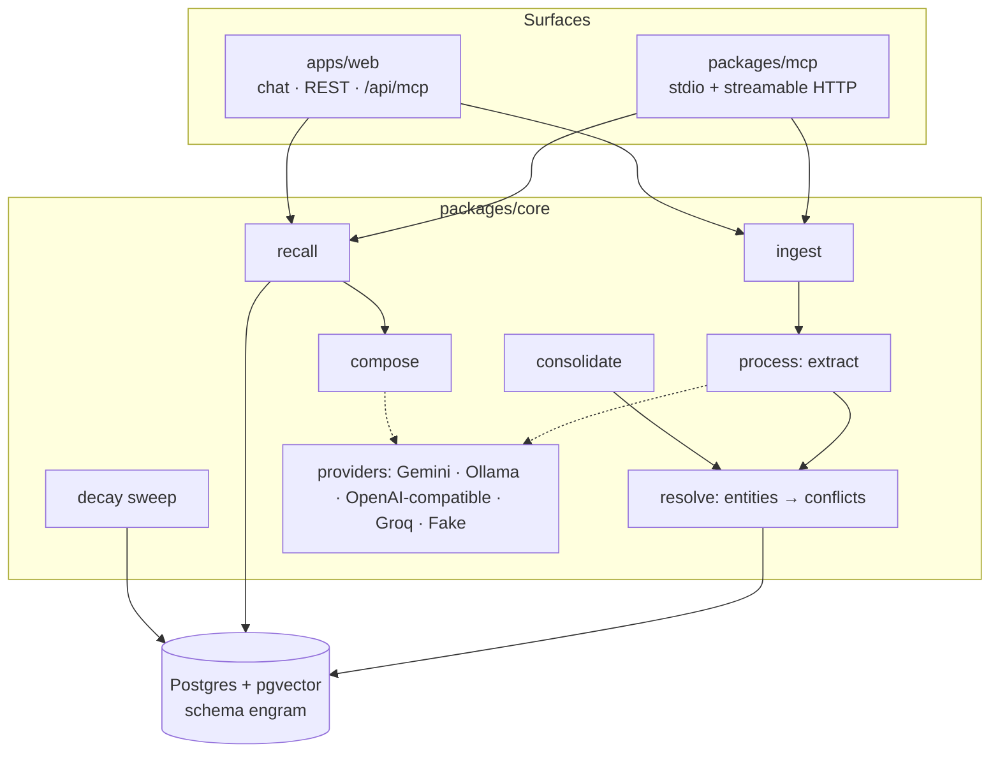
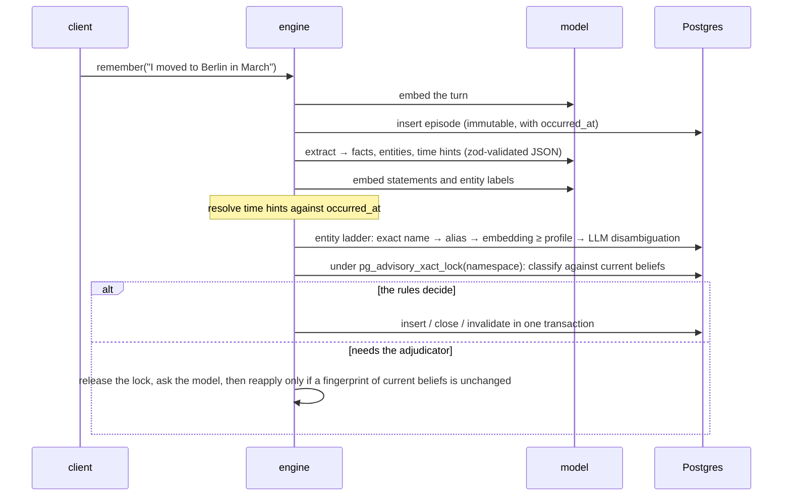
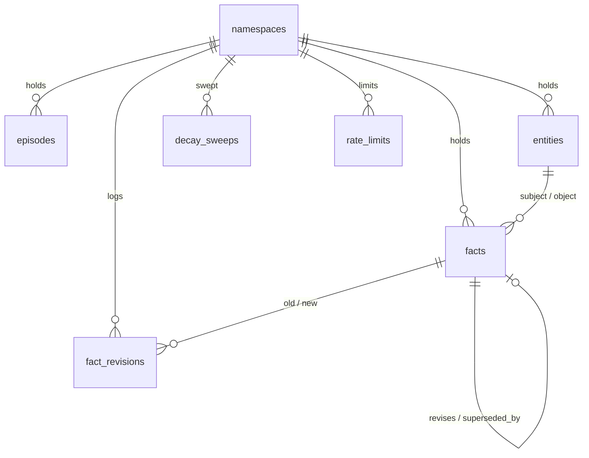

# Architecture

How Engram works, part by part. [SPEC.md](SPEC.md) is the source of truth, and [DECISIONS.md](../DECISIONS.md) records why each part is the way it is. The [`/architecture`](https://engram-lime.vercel.app/architecture) explorer shows every section below interactively, on the repository's own data. Each heading links to its chapter.

## The parts

- **packages/core** is a library with no server of its own. Every model call goes through one `Provider` interface: seven structured methods plus `embed`, each reply validated by zod and repaired once if needed.
- **packages/mcp** serves six tools over stdio, for local clients, and over HTTP.
- **apps/web** is Next.js route handlers and pages, built from injected dependencies, so tests call handlers directly with the scripted model and the local database.

## The write path ([chapter 2](https://engram-lime.vercel.app/architecture#write-path))

- **No model call ever runs under the lock.** The adjudicator's answer is re-checked against a fingerprint of the current beliefs before it applies (ADR-006, ADR-008).
- **Per-turn extraction sees only the turn itself.** A reference back to an earlier turn extracts nothing (ledger row 49, P11).

## Bitemporal facts ([chapters 3–4](https://engram-lime.vercel.app/architecture#bitemporal))

| column | meaning |
|---|---|
| `valid_from`, `valid_to` | when it was true in the world (`-infinity` for an unknown start, ADR-007) |
| `recorded_at`, `invalidated_at` | when Engram believed it |
| `revises`, `superseded_by` | links between the versions of one fact |

The canonical as-of predicate is the only way reads filter, never on `status`:
`recorded_at <= K and (invalidated_at is null or invalidated_at > K) and valid_from <= T and (valid_to is null or valid_to > T)`.

An **update** ("moved to Berlin in March") runs in one transaction, at one timestamp `t`:
1. insert Berlin;
2. insert a closed copy of Paris, valid until March;
3. set the original Paris row's `invalidated_at = t`.

**Corrections** retract. **Backfills** of older history close against the existing history without touching the present, and an overlapping backfill goes to the adjudicator. SPEC §7.4's 15 cases are integration tests, and consolidation can't revive a claim the user corrected (ADR-021).

## Entity resolution and similarity profiles ([chapter 5](https://engram-lime.vercel.app/architecture#resolution))

Thresholds don't transfer between embedding models: embeddinggemma scores related labels about 0.15 lower than Gemini. So each namespace records its embedding space, and each model has a calibrated profile, built from 537 labelled dev pairs. It covers:
- entity match;
- description conflict;
- merge;
- entity search;
- drift;
- recall floor.

Switching models is an explicit `db:reembed`, never a silent mix (ADR-017).

## Recall ([chapter 6](https://engram-lime.vercel.app/architecture#recall))

1. **Four candidate lists, all under the as-of filter:**
   - fact vectors (HNSW, top 40);
   - episode vectors (top 20);
   - Postgres full text (top 20);
   - a one-hop entity-graph expansion from the top seeds.
2. **Fusion:** reciprocal rank fusion with k = 60, multiplied by mild priors, `1 + 0.1·recency + 0.1·importance`.
3. **Abstention:** if the best raw cosine is below the profile's floor (0.5 for Gemini), recall returns nothing. On dev-long the floor is only a safety net; the composer does the abstaining (ADR-010).

`recall({ trace: true })` returns the ranked lists and every candidate's scores.

## Decay ([chapter 7](https://engram-lime.vercel.app/architecture#decay))

`score = 0.50·e^(−Δt/τ) + 0.25·min(1, ln(1+access)/ln 21) + 0.25·importance`, with τ = 14 days in `working` and 90 in `long_term`. Below 0.15, a fact is archived (reversible).

The score tends to `0.25·importance`, so a fact is archivable by decay **if and only if** its importance is below 0.6. The sweep is one SQL function that takes `now` as a parameter, so tests drive it with a simulated clock.

## Consolidation ([chapter 8](https://engram-lime.vercel.app/architecture#consolidation))

Unconsolidated turns are grouped by session, split on drift, and capped at 12. A cluster whose turns all score below importance 0.3 is skipped with no call. Each other cluster gets one summarize call, producing a summary episode and fact candidates that cite their turns. Those candidates go through the same write path. Promotion to `long_term` happens only here.

## Storage ([chapter 10](https://engram-lime.vercel.app/architecture#storage))

- **Indexes:** HNSW on three embeddings, GIN full text on statements and turns, a partial index on current beliefs, and a partial unique index giving one `is_self` entity per namespace.
- **Isolation:** everything lives in the `engram` schema.
- **Migrations:** portable migrations run on both databases (local Docker and hosted Neon); `sql/hosted/` holds the hosted-only SQL (ADR-014).

## Providers and local mode ([chapter 11](https://engram-lime.vercel.app/architecture#providers))

| provider | role |
|---|---|
| Gemini 3.5 flash-lite + gemini-embedding-2 | the hosted demo and the bench |
| Ollama: qwen3.5:9b + embeddinggemma:300m | local mode: nothing leaves the machine |
| any OpenAI-compatible server | llama.cpp, LM Studio, vLLM |
| Groq `gpt-oss-120b` | the bench's judge |
| FakeProvider | every unit test |

- **Key rotation:** Gemini keys rotate per lane, because the generation and embedding quotas run out separately (ADR-018).
- **Embedding quota:** it counts texts, not requests, so the bench caches vectors per text.

## Interfaces ([chapter 12](https://engram-lime.vercel.app/architecture#interfaces))

- **One token model for MCP and REST:** `ENGRAM_MCP_TOKENS` maps each token to its namespace, compared in constant time.
- **The demo:**
  - visitors get a cookie whose SHA-256 is their namespace slug;
  - reads with no credential see the read-only showcase;
  - limits: 5 sessions an hour and 20 a day per IP (keyed by `HMAC(day ‖ ip)`), 30 turns an hour per namespace, and 120 turns a day in total. Each limit is one atomic upsert, and a refused turn never reaches a model (ADR-019).

## Benchmarks ([chapter 13](https://engram-lime.vercel.app/architecture#benchmarks))

- **Engram-Bench** has dev, dev-long and test splits, generated from code-defined ground truth (ADR-009).
- **LongMemEval-S** is the external check: a 98-item stratified subset, run on local embeddings to fit free quotas.
- **The judge** is validated against blind hand labels (κ).

The README's tables are generated from `bench/reports/`.
